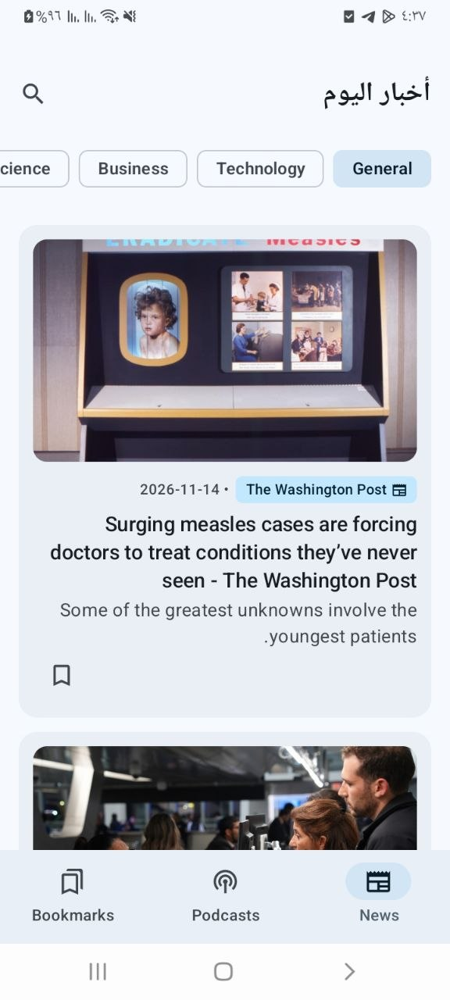
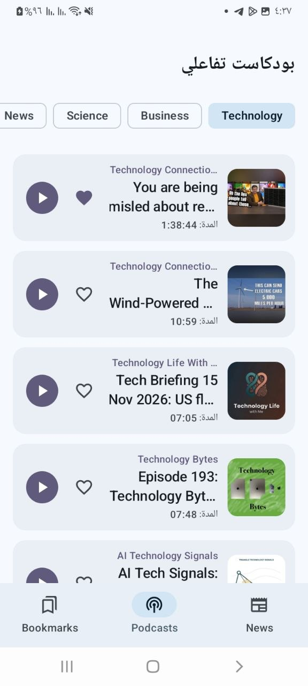
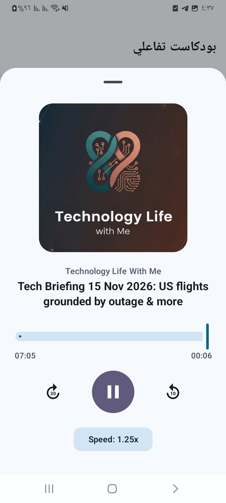
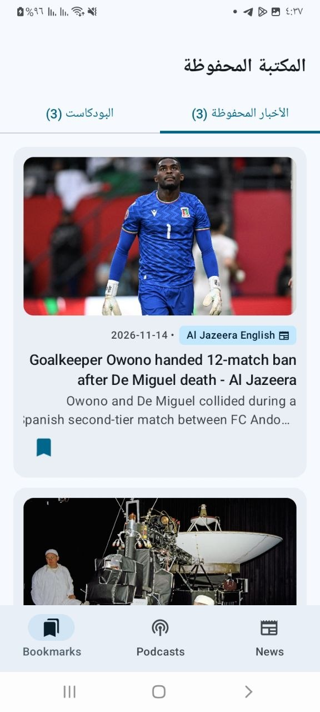

# 📰🎧 News & Interactive Podcast Player

A modern, production-grade Android application built with **Kotlin** and **Jetpack Compose**, combining real-time global news headlines with an interactive background podcast streaming experience. Designed following **Clean Architecture** and **MVVM** best practices.

---

## ✨ Key Features

* **Infinite News Feed (Paging 3):** Smooth pagination across multiple categories (*General, Technology, Business, Science, Health, Sports, Entertainment*) with debounced real-time search.
* **Background Audio Streaming (Media3 / ExoPlayer):** Seamless background podcast playback powered by `MediaSessionService`, complete with lock-screen and notification media controls.
* **Interactive Mini & Full-Screen Players:** Animated `MiniPodcastPlayer` docked above the navigation bar that expands into a full-screen `ModalBottomSheet` featuring an interactive seek slider, skip controls (-10s/+30s), and dynamic playback speed adjustment (`1.0x` – `2.0x`).
* **Offline Bookmarks & Favorites (Room):** Persistent local storage for saved news articles and favorite podcast episodes, synchronized reactively with the UI via `StateFlow` and `combine`.
* **Material 3 & Dynamic Theming:** Adaptive UI supporting Light/Dark modes and Android 12+ Dynamic Colors.
* **Secure API Key Management:** API credentials are decoupled from source control using `local.properties` and `BuildConfig`.

---

## 🏗️ Architecture & Tech Stack

The project strictly adheres to **Clean Architecture** principles, separating responsibilities across three distinct layers:

* **Presentation Layer:** Jetpack Compose, Material 3, Navigation Compose, Lifecycle-aware `StateFlow` & `SharedFlow`, ViewModels.
* **Domain Layer:** Pure Kotlin business models, Repository interfaces, and single-responsibility UseCases.
* **Data Layer:** Retrofit & OkHttp (with logging interceptor), Paging 3 (`PagingSource`), Room Database (DAOs & Entities), and DTO-to-Domain Mappers.

### Libraries & Tools
* **UI:** Jetpack Compose, Material 3, Coil 3 (Async Image Loading)
* **Dependency Injection:** Dagger Hilt
* **Asynchronous & Reactive:** Kotlin Coroutines, Flow, StateFlow, SharedFlow
* **Media Playback:** AndroidX Media3 (`media3-exoplayer`, `media3-session`)
* **Networking & Persistence:** Retrofit 2, OkHttp 4, Paging 3, Room

---

## 📸 Screenshots

| News Feed | Podcasts | Full Player | Bookmarks |
| :---: | :---: | :---: | :---: |
|  |  |  |  |

---

## 🚀 Setup & Installation

1. **Clone the repository:**
   ```bash
   git clone [https://github.com/mo7ammedtabasi/NewsPodcastPlayerApp.git](https://github.com/mo7ammedtabasi/NewsPodcastPlayerApp.git)